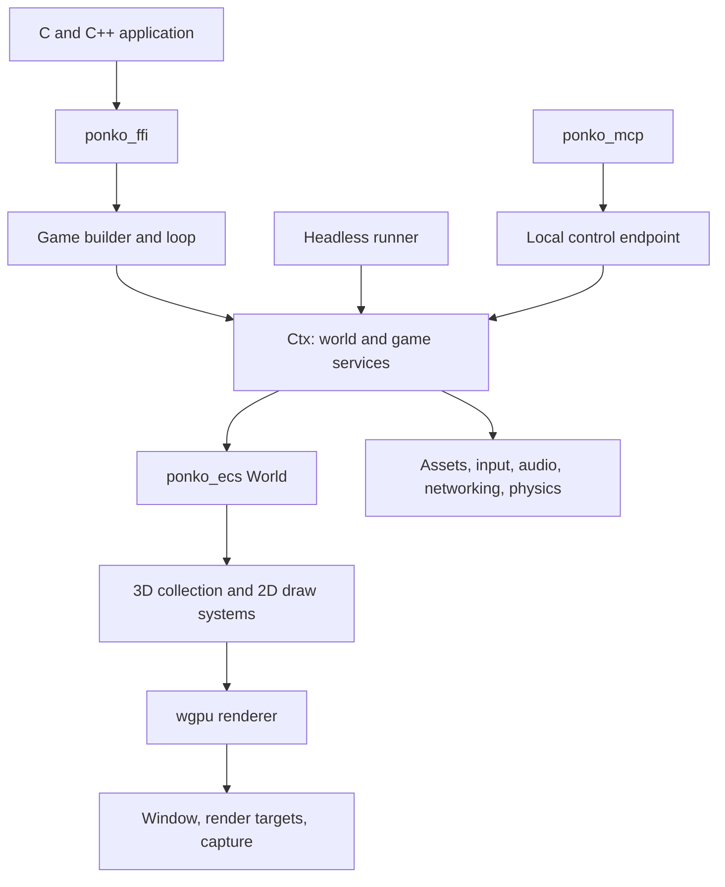

# Ponko architecture

Ponko integrates an archetype ECS, fixed-step simulation, a wgpu renderer and game services behind a code-first Rust API. C and C++ enter through a separate FFI crate; inspection tools use a local control protocol. This describes the source in this checkout, not the target architecture in [ROADMAP.md](ROADMAP.md). Source inspection confirms that mechanisms exist; it does not establish production readiness, performance on your hardware or feature parity across targets.

Package names and source directories use `ponko_*`. New native code uses
`include/ponko.h` and `include/ponko.hpp`; legacy headers remain available as
part of the [compatibility migration](book/src/naming.md).

## Crate and ownership boundaries

| Boundary | Current responsibility and source |
|---|---|
| `ponko` | Public facade and integrated game services: [src/lib.rs](src/lib.rs), [src/ctx.rs](src/ctx.rs), [src/game.rs](src/game.rs). Feature flags select windowing, audio, inspector, physics, navigation and 3D. |
| `ponko_ecs` | Entities, column storage, queries, commands and resources: [crates/ponko_ecs/src](crates/ponko_ecs/src). It does not own the window or GPU. |
| Rendering | Device/surface and frame coordination in [src/render/gpu.rs](src/render/gpu.rs); 3D coordination in [src/render/gpu3d.rs](src/render/gpu3d.rs); game-facing 3D types in [src/three](src/three). |
| `ponko_mcp` | Stdio MCP server, tool schemas, instance discovery and forwarding to a running game: [crates/ponko_mcp/src/lib.rs](crates/ponko_mcp/src/lib.rs). |
| `ponko_ffi` | Exported native API and handle/callback conversion: [crates/ponko_ffi](crates/ponko_ffi), [include/crabby.h](include/crabby.h), [include/crabby.hpp](include/crabby.hpp). |
| `ponko_unity` | External asset/scene conversion tooling: [crates/ponko_unity](crates/ponko_unity). This is an importer, not a Unity runtime or C# compatibility layer. |
| `ponko_bench` | Development benchmarks: [crates/ponko_bench](crates/ponko_bench). Results need workload, hardware, build and feature context. |

The engine is integrated rather than a collection of independent service crates. `Ctx` gives systems broad access to state, while the 3D collector bridges ECS components and GPU-oriented frame data. These convenient boundaries also create coupling: a scheduler cannot infer a system's access from its closure signature, and renderer ownership changes can affect assets, temporal history and pass sequencing together.

## Game loop and scheduling

[Game](src/game.rs) stores systems as `FnMut(&mut Ctx)` callbacks. `run_systems`, `run_sim_tick` and `run_one` define the current order:

1. Update retained UI and begin frame timings.
2. Run the due fixed simulation ticks. Lockstep can defer a tick until peer inputs are ready while the windowed frame continues.
3. Run `Frame` systems, then explicitly registered `Animate` systems.
4. Update built-in animation and particles when 3D is enabled.
5. Run late systems, then drawing systems; update positional audio.
6. The windowed application prepares and submits rendering through [src/game](src/game) and [src/render](src/render).

`Game::add(Phase, system)` selects an explicit sequential bucket. Each fixed tick
runs `Input`, `BeforePhysics`, `Physics`, `AfterPhysics`, then `SimLast`. Legacy
`sim_system` registrations use `AfterPhysics`; installing physics always places
the step in `Physics`, independent of builder order. Legacy `system` and
`late_system` map to `Frame` and `Late`; built-in drawing uses `Draw`. Within a
phase registration order is preserved. Automatic 3D animation, particles and
positional audio remain hard-coded boundaries in this first phase API stage.

`run_one` applies deferred commands after each system. `sim_system_every` schedules a system at a tick interval and phase; it is simulation frequency control, not parallel scheduling. Events have reader/lifetime machinery in [src/events.rs](src/events.rs). Changes to barriers must preserve the currently observable command and event behavior.

**Systems currently execute sequentially.** Parallel ECS iteration and native parallel GPU command recording are separate mechanisms. There is no general dependency-aware parallel system scheduler in this loop. Systems can declare their access (`SystemAccess`, [#137](https://github.com/ponkoengine/ponko/issues/137)); view systems (`Game::add_view`) get a restricted `SystemView` that enforces the declaration, and the batch barrier for commands and events is documented in the guide's "Declared system access" chapter. The optional scheduler that uses them is [#138](https://github.com/ponkoengine/ponko/issues/138). Arbitrary `&mut Ctx` callbacks remain exclusive; annotations alone cannot make concurrent mutable access sound, so only view systems may ever be batched.

Fixed steps and seeded random streams support repeatability, but deterministic gameplay also depends on user code, math and physics configuration. Follow [STABILITY.md](STABILITY.md), including its same-build lockstep and physics restrictions. A future scheduler must define ordering and reductions before claiming equivalent determinism.

## ECS storage and queries

[World](crates/ponko_ecs/src/world.rs) manages generational entity locations and archetypes. [Storage](crates/ponko_ecs/src/storage.rs) holds type-erased component columns; structural changes move entities between layouts. This custom storage remains the baseline, rather than a candidate for replacement without measurements.

[Typed queries](crates/ponko_ecs/src/query.rs) resolve component IDs, validate aliasing, match archetypes and fetch row references. They support shared/mutable references, optional components, entity IDs, tuples up to eight elements and bounded `with`/`without` filtering. Matching scans archetypes by default. `Query::cached()` opts into world-owned matching indices with incremental generation invalidation; small worlds and saturated signature caches fall back to scanning. Column pointers are resolved under each live query borrow. [Change detection](crates/ponko_ecs/src/change.rs) is opt-in per component: a tracked column keeps two tick stamps per row behind its values, `Added`/`Changed` filters pick rows inside matching archetypes, and removals go to a per-component log. A world that tracks nothing keeps no stamps and runs the same loops as before.

Rayon-backed query methods partition disjoint rows: the calling thread lines up the matching rows of every archetype in query order (a reused, world-owned work plan), then one parallel pass runs chunks of it, so many small archetypes share chunks and big ones split. Indexed parallel operations preserve their documented output ordering, but callers must make per-entity work safe and avoid nondeterministic external effects. If the mapper of `par_collect_into` panics, the results already written are dropped and the output is left empty with its allocation kept ([#142](https://github.com/ponkoengine/ponko/issues/142)). For queries over small archetypes only, the choice between the calling thread and the pool depends on the measured time of the first rows, so the threads and order that run per-entity side effects are not reproducible; indexed positions and collected order are. See [queries tests](crates/ponko_ecs/tests/queries.rs), [parallel tests](crates/ponko_ecs/tests/parallel.rs), and [#133](https://github.com/ponkoengine/ponko/issues/133) for the broader proposed differential/Miri suite.

## Scene preparation and renderer

[Collection](src/three/collect.rs) turns models, transforms, lights, terrain, skinning and camera state into a reusable `Frame3D`. It sorts instances into mesh runs for camera and shadow views, selects LOD and maintains frame-related caches. Reused vectors reduce repeated allocation; that is distinct from general incremental extraction of unchanged ECS objects.

[Renderer3D](src/render/gpu3d.rs) coordinates pipelines, targets, temporal state and pass encoding. Its `Part` enum expresses recording stages: prelude/compute and atmosphere, shadows, target-camera views, GI, depth prepass, opaque, optional scene-copy/transparency and post-processing. Exact work depends on enabled features. Temporal antialiasing and AO use motion/history data; SSR, GI and post effects have dedicated modules. Sprites and UI composite afterward.

Native builds can record parts using Rayon; browser GPU handles stay on one thread. [Static instances](src/render/gpu3d/instances.rs) already have compute culling and indirect drawing on supported devices. This does not mean every model uses a fully GPU-driven scene pipeline. CPU/downlevel paths and device limits remain part of the contract.

The renderer already has effect modules and limited extension APIs for surface shaders, screen effects and compute: [three/api.rs](src/three/api.rs), [effect.rs](src/three/effect.rs), [compute.rs](src/three/compute.rs). A constrained arbitrary pass insertion API with declared hazards is still proposed in [#155](https://github.com/ponkoengine/ponko/issues/155). `Part` is not a general validated render graph.

The intended evolution is smaller resource, pipeline, preparation and encoding responsibilities, followed by lightweight explicit internal dependencies. It retains wgpu and the existing public workflow. [#134](https://github.com/ponkoengine/ponko/issues/134), [#135](https://github.com/ponkoengine/ponko/issues/135), [#136](https://github.com/ponkoengine/ponko/issues/136), [#147](https://github.com/ponkoengine/ponko/issues/147) and [#148](https://github.com/ponkoengine/ponko/issues/148) describe the foundations and next steps; no giant public graph or mandatory plugin framework is assumed.

## Assets, scenes and lifetime

[assets.rs](src/assets.rs) resolves native files relative to asset roots; web startup prefetches an asset index into memory. [Textures](src/texture.rs), [3D assets](src/three/api.rs), [glTF](src/three/gltf.rs), and [hot reload](src/hot_reload.rs) connect decoded data and handles to runtime resources. [Scenes and prefabs](src/scene.rs) use reflected JSON components; [reflection](src/reflect.rs) is also shared by inspection and world serialization. Saving an ECS world is not a promise to serialize every external service or GPU allocation automatically.

[Job and CellStreamer](src/stream.rs) support background CPU work and cell load/drop decisions. GPU creation belongs on the game's thread after preparation. Browser jobs execute synchronously in the current implementation. These helpers are useful building blocks, but do not constitute automatic texture mip/mesh residency management with a GPU memory budget; that remains [#154](https://github.com/ponkoengine/ponko/issues/154). Ownership/leak diagnostics remain an audit area in [#161](https://github.com/ponkoengine/ponko/issues/161).

## Physics, networking and other services

[2D physics](src/physics.rs) and [3D physics](src/physics3d) integrate Rapier behind features. `Game::physics` and `physics3d` install fixed-step systems; ECS components and physics state synchronize at that boundary. Characters, joints and vehicles extend the 3D integration. [Navigation](src/nav3d) uses optional Recast/Detour functionality. These services are not implemented by the ECS scheduler itself.

[Net](src/net.rs) provides lockstep; [messages](src/net/messages.rs), [snapshots](src/net/snapshots.rs), [interest](src/net/interest.rs) and optional Steam transports provide additional networking building blocks. Peer coordination, authority and replication choices remain game-level responsibilities. Loopback tests do not prove internet, relay or live Steam-client behavior.

[Audio](src/audio.rs) uses Kira when enabled and a silent API otherwise. [Input](src/input.rs), [actions](src/actions.rs), [gamepad](src/gamepad.rs), [retained UI](src/ui) and [text](src/text.rs) form integrated game-facing services. Platform support for each backend must be checked separately; their presence does not establish accessibility completeness.

## Headless execution and AI observation

`Game::run_headless` creates a context, runs setup and fixed simulation ticks, and returns the world. Frame, late and drawing systems do not run. With default features disabled, [render/none.rs](src/render/none.rs) supplies the no-GPU path; the audio API can remain silent. Headless behavior tests therefore complement GPU tests rather than substitute for them.

The opt-in [control endpoint](src/control.rs) exposes runtime operations at engine-controlled boundaries. [MCP tools](crates/ponko_mcp/src/lib.rs) discover instances, launch games, inspect/edit reflected state, operate scenes, pause/step, capture screenshots, retrieve logs and performance information. Reflection registration determines what component data tools can understand. [Profiling](src/perf_report.rs), [scope instrumentation](src/scope.rs) and [GPU timers](src/render/timer.rs) provide existing evidence sources.

The complete autonomous edit/build/observe/repair loop is a development direction. Custom shader errors and reload results are available as data through `Graphics::shader_status` ([shader_status.rs](src/three/shader_status.rs)) and the `shader_status` MCP tool. Scheduler explanations and a richer render-pass inspector remain backlog work. Screenshots require a rendering-capable instance; a headless state assertion cannot establish visual correctness. See the [agent guide](book/src/agents.md) and [roadmap](ROADMAP.md).

## Rust, C and C++ compatibility

Rust applications use `ponko`; native applications call the FFI exports directly or through the header-only C++ wrapper. C++ callbacks and dynamic component columns bridge into the same world and loop. The headers retain existing ABI names. Rust-only contributions may land independently. Maintainers coordinate native coverage and record follow-ups; existing binding compatibility must remain correct. Do not infer universal parity from the existence of the wrapper.

[STABILITY.md](STABILITY.md) defines the versioning, saved-world, MSRV, determinism and MCP compatibility policy. Package renaming does not authorize changing ABI symbols, persisted format tags or established tool contracts. Architectural improvements must preserve these boundaries or undergo an explicit compatibility decision.
